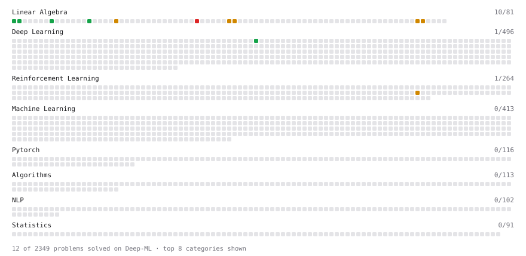

# Deep-ML

My machine learning practice from [Deep-ML](https://www.deep-ml.com). Every solution here was written by hand.

**9** solved · 6 problems · 0 labs · 3 math

[**Browse the interactive portfolio**](https://Dheeraj-1103.github.io/deep-ml/) to replay this filling in over time.

## Problems

| | Difficulty | Solved | |
| --- | --- | --- | --- |
| [Calculate 2x2 Matrix Inverse](https://www.deep-ml.com/problems/8) | easy | 2026-11-19 | [solution](problems/0008-calculate-2x2-matrix-inverse) |
| [Convert Vector to Diagonal Matrix](https://www.deep-ml.com/problems/35) | easy | 2026-11-18 | [solution](problems/0035-convert-vector-to-diagonal-matrix) |
| [Matrix-Vector Dot Product](https://www.deep-ml.com/problems/1) | easy | 2026-11-17 | [solution](problems/0001-matrix-vector-dot-product) |
| [Nesterov Accelerated Gradient Optimizer](https://www.deep-ml.com/problems/150) | easy | 2026-11-17 | [solution](problems/0150-nesterov-accelerated-gradient-optimizer) |
| [Transpose of a Matrix](https://www.deep-ml.com/problems/2) | easy | 2026-11-17 | [solution](problems/0002-transpose-of-a-matrix) |
| [Random Sample Greedy Search](https://www.deep-ml.com/problems/638) | medium | 2026-11-19 | [solution](problems/0638-random-sample-greedy-search) |

## Math

| | Difficulty | Solved | |
| --- | --- | --- | --- |
| [Vector Operations](https://www.deep-ml.com/math-problems/7) | easy | 2026-11-17 | [solution](math/0007-vector-operations) |
| [Matrix Multiplication](https://www.deep-ml.com/math-problems/10) | medium | 2026-11-17 | [solution](math/0010-matrix-multiplication) |
| [Woodbury, Sherman-Morrison and the Matrix Determinant Lemma](https://www.deep-ml.com/math-problems/410) | medium | 2026-11-19 | [solution](math/0410-woodbury-sherman-morrison-and-the-matrix-determinant-lemma) |

---

_This file is regenerated by Deep-ML on every push._
